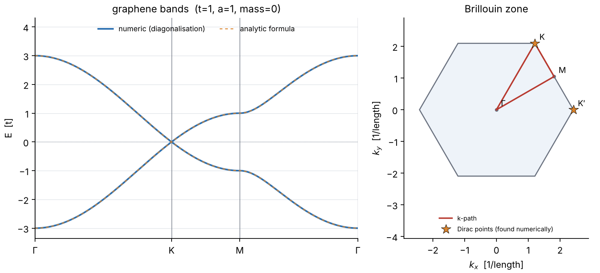
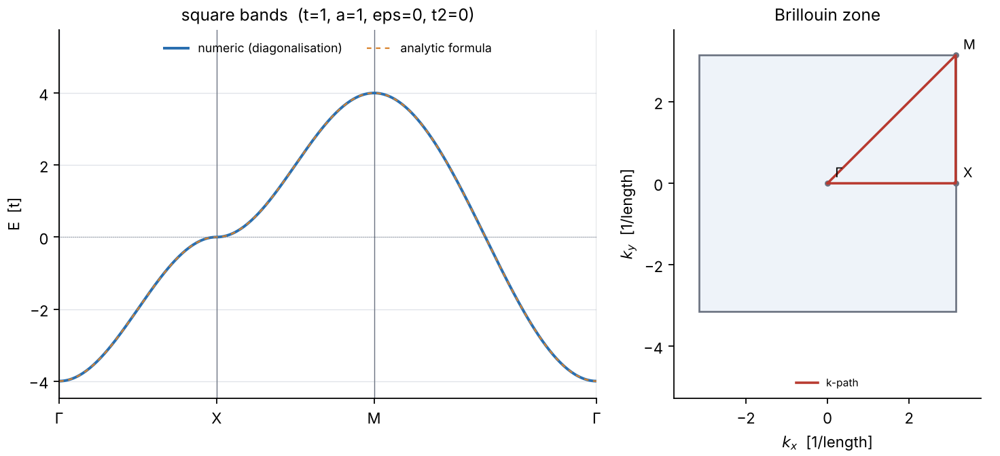
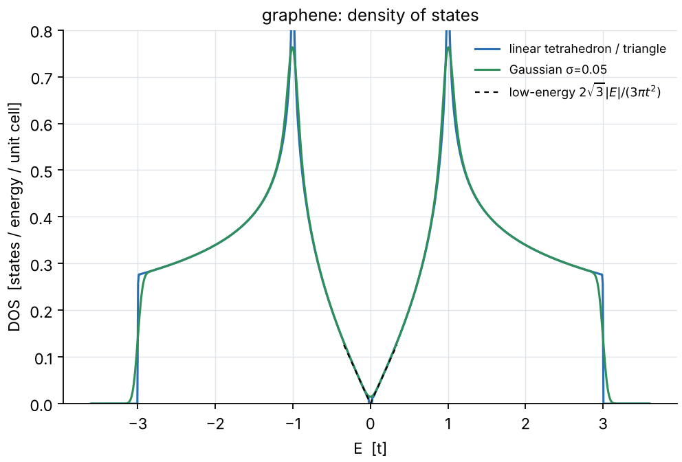
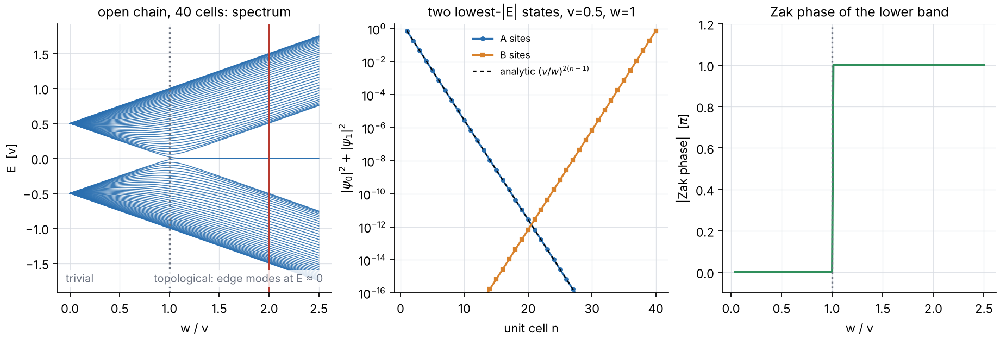
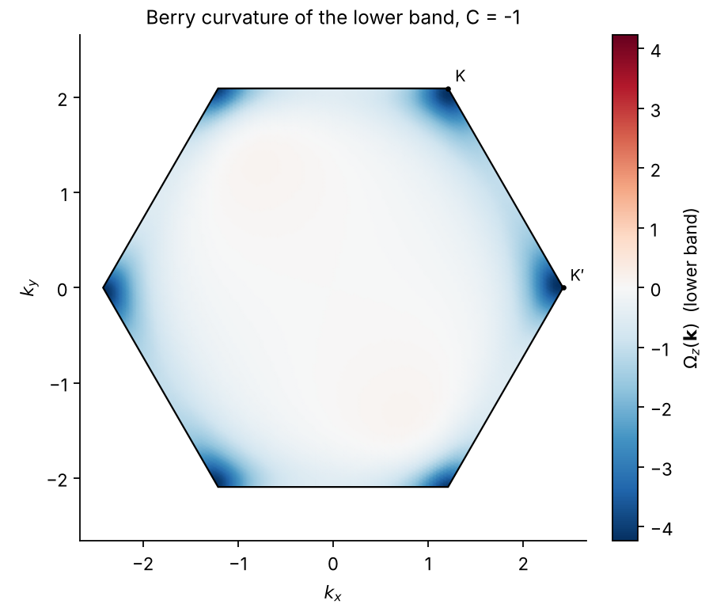
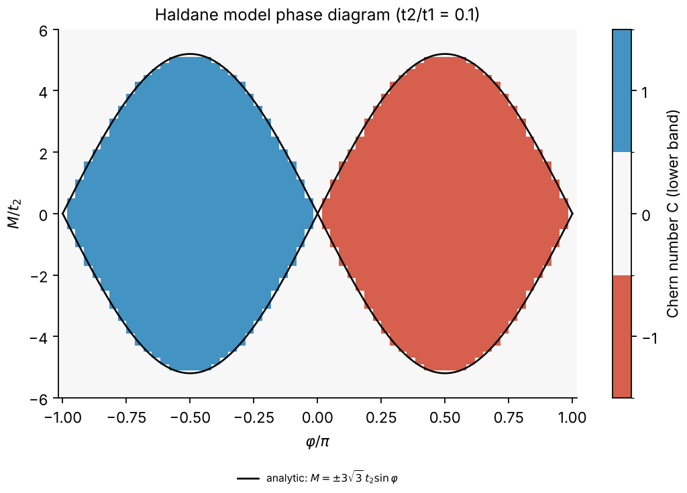
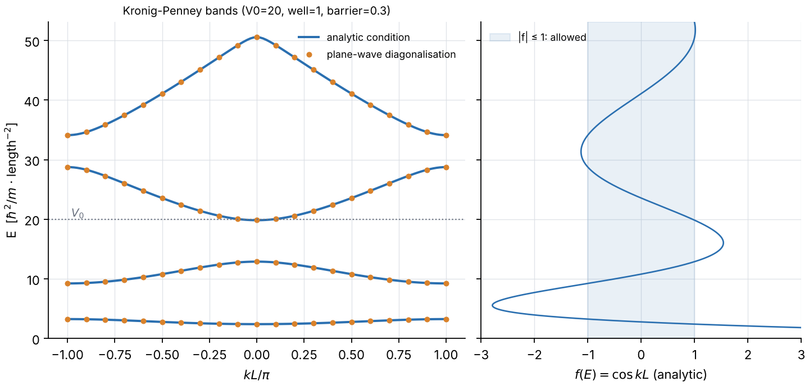

# tblab: a tight-binding lab, checked against analytic results

`tblab` is a small, from-scratch Python package for the tight-binding toolbox of an
introductory solid-state course: band structures along high-symmetry paths, density of states
(linear tetrahedron and Gaussian), topological edge states and Zak phase (SSH chain), Berry
curvature and Chern numbers (Haldane model), and the Kronig-Penney model.

The point of the project is not the models themselves (they are textbook) but that **every
headline claim is tested against a closed-form result**: `E(k) = -2t cos k`, the Dirac velocity
`3ta/2`, `C = ±1` in the topological Haldane phase, zero-energy SSH edge modes, the analytic
Kronig-Penney condition, and so on. All numbers and figures below were produced by running the
code in this repository (see [Reproducing the figures](#reproducing-the-figures)).

Author: Georgii Baiev (physics student, California State University, Northridge). MIT licence.



## Install

Python 3.10+ and `numpy`, `scipy`, `matplotlib`.

```bash
git clone <this repository>
cd tightbinding-lab
python -m venv .venv && source .venv/bin/activate
pip install -e ".[dev]"      # package + pytest, ruff, mypy
```

## Command-line usage

Every command writes a PNG **and** a JSON file (parameters, results, raw arrays) into `--out`
(default `./tblab_output`).

```bash
tblab bands graphene --path G-K-M-G            # the example from the brief
tblab bands square   --path G-X-M-G
tblab bands ssh      --v 0.5 --w 1.0
tblab bands haldane  --t2 0.1 --phi pi/2 --path G-K-M-Kp-G
tblab bands graphene --t 2.7 --a 1.42 --unit eV   # physical-looking parameters, your choice

tblab dos graphene --method both --nk 160      # tetrahedron + Gaussian
tblab dos square

tblab ssh --v 0.5 --w 1.0 --cells 40           # open chain: edge states, Zak phase
tblab berry haldane --t2 0.1 --phi pi/2        # Berry curvature map + Chern number
tblab phase --t2 0.1                           # Haldane phase diagram (phi, M/t2)
tblab kp --v0 20 --well 1 --barrier 0.3        # Kronig-Penney vs plane waves
tblab verify                                   # analytic-vs-numeric table (exit code 1 on failure)
```

Example, with the real output of `tblab bands graphene --path G-K-M-G --out docs`:

```text
wrote docs/graphene_bands.png
wrote docs/graphene_bands.json
```

and the `results` block of that JSON file (abridged):

```json
{
  "labels": ["G", "K", "M", "G"],
  "max_abs_error_vs_analytic": 1.0e-15,
  "direct_gap_at_special_points": {"G": 6.0, "K": 1.35e-15, "Kp": 8.0e-16, "M": 2.0},
  "dirac_points_found_fractional": [[0.3333, 0.6667], [0.6667, 0.3333]],
  "fermi_velocity_numeric": 1.4999999981,
  "fermi_velocity_analytic_3ta/2": 1.5
}
```

Path labels: `G` (also `Gamma`, `Γ`), `K`, `Kp` (also `K'`), `M`, `X`. Energies are in units of the
hopping `t` unless you pass `--t` / `--unit`. The same functionality is available as a library:

```python
from tblab import Graphene, compute_bands, dirac_velocity

res = compute_bands(Graphene(t=1.0, a=1.0), "G-K-M-G", nk=300)
print(dirac_velocity(Graphene(), "K"))  # 1.49999999...  (= 3ta/2)
```

## What it computes, and how it is checked

### Band structures (chain, square lattice, graphene, SSH, Haldane)

Models are Bloch Hamiltonians `H(k)` built from hopping lists; bands are `numpy.linalg.eigh`
along a path whose points are spaced proportionally to Cartesian length. Brillouin zones are
constructed as Voronoi cells of the reciprocal lattice.

- 1D chain: `max |E_numeric(k) + 2t cos(ka)|` is 0.0 in the default CLI run and below 1e-13 in the
  tests (random `t, a, eps`, plus a next-nearest-neighbour term).
- Graphene (`a` = C-C distance, lattice constant `√3 a`): bands equal `±|f(k)|` to 1e-15; bandwidth
  `6t`; `E(M) = ±t`; gap at `K` and `K'` is zero to 1e-15; sublattice mass `m` gives gap `2|m|`.
- Dirac velocity from the numerical bands: `1.4999999981` for `t = a = 1` versus analytic
  `3ta/2 = 1.5` (relative error 1.3e-9; the estimate averages `±q` because trigonal warping
  makes the one-sided error O(q), and is verified to converge as `dq²`). Tests cover several `(t, a)`,
  both valleys and five directions.
- `find_dirac_points` finds the gap minima numerically (grid scan + Nelder-Mead) and returns
  `(1/3, 2/3)` and `(2/3, 1/3)` without being told where they are.



### Density of states

- **Gaussian broadening** on a uniform `k` grid.
- **Linear tetrahedron method** (segments in 1D, triangles in 2D): each simplex is a linear
  interpolation of `E_n(k)`. The code evaluates the *exact cumulative distribution* of that
  interpolant at bin edges and differences it, so `∫ DOS dE` equals the band count to rounding
  error (tested to 1e-10) and flat or degenerate triangles (Dirac point on a grid node, band
  edges) cannot produce spikes. This was a bug in my first version (a naive pointwise formula
  gave `∫ DOS = 1e9` for graphene because a vertex sat exactly on the Dirac point); the cumulative
  formulation fixed it.

| check | result (measured) |
| --- | --- |
| square lattice, tetrahedron vs `K(√(1-(E/4t)²))/(2π² t)`, `0.3t<\|E\|<3.7t`, nk=200 | max relative deviation 0.31 % (test tolerance 1 %) |
| square lattice, Gaussian σ=0.04, same window, nk=200 | max relative deviation 0.24 % (test tolerance 0.5 %) |
| chain, cumulative DOS vs `1/2 + arcsin(E/2t)/π`, nk=1500 | max deviation 1.4e-5, shrinking ~1/nk² |
| graphene, `∫ DOS dE` (both bands) | 2.0 (to 1e-10) |
| graphene, tetrahedron DOS (nk=240) vs low-energy `2√3 \|E\| / (3π t²)`, `0.05t<\|E\|<0.3t` | max deviation 3.0 % (4.3 % up to `0.35t` in the CLI JSON); this is mostly a real deviation of NN graphene from the linear law (O(E²)), not numerical error |
| graphene van Hove peak | at `\|E\| = t` (within 0.02) |



### SSH chain: edge states and the Zak phase

`H(k) = [[0, v + w e^{-ik}], [c.c., 0]]`, inversion-symmetric unit cell.

- Open chain of 40 cells, `v = 0.5, w = 1`: the two states closest to zero have
  `E = ±6.8e-13` (analytic scale `w (v/w)^N ≈ 1e-12`); the next level is at `0.503` against bulk
  half-gap `|v-w| = 0.5`.
- The edge mode on the left edge decays as `ψ_A(n+1)/ψ_A(n) = -v/w`; the fitted density decay
  gives `|v/w| = 0.5000000000000111`. The test also checks that the analytic geometric-series state
  lies in the span of the two numerical near-zero eigenvectors to 1e-9.
- In the trivial phase (`v > w`) there are no in-gap states (`min|E| > 0.95 |v-w|`).
- Zak phase of the lower band from a discretised Wilson loop: `|γ| = 3.141592653589793` for `w > v`,
  `3e-16` for `w < v`; matches the winding number of `v + w e^{ik}` (0 or 1). The loop product is
  verified to be invariant under random per-`k` gauge phases.



### Haldane model: Berry curvature and Chern numbers

Honeycomb lattice with `-t1` nearest-neighbour hopping, `t2 e^{iνφ}` next-nearest-neighbour hopping
(ν computed from the geometry of the hop, not hard-coded) and a sublattice mass `M`. The Chern
number is computed with the Fukui-Hatsugai-Suzuki link-variable method on an `nk × nk` grid, and
the Berry curvature is the plaquette flux per unit area.

- `t2 = 0.1, φ = π/2, M = 0`: `C = -1` (the raw plaquette sum is -1.0 to machine precision, no rounding
  needed). In the tests the integer is unchanged for 25 to 50 points per direction and shifted grid origins.
- `M = 0.8` (beyond `3√3 t2 = 0.5196`): `C = 0` to 1e-16.
- `C(φ) = -C(-φ)`, `C(M) = C(-M)`.
- Valley gaps are `2 |M ∓ 3√3 t2 sin φ|`, so the gap closes at `M = ±3√3 t2 sin φ`; verified to
  1e-12 at several `(φ, M)`.
- Independent cross-check of the Berry curvature: the `d`-vector formula `½ d̂·(∂x d̂ × ∂y d̂)`
  (finite-difference derivatives) agrees with the plaquette fluxes with a maximum deviation of
  `7.8e-3` against a peak of `4.25` at nk = 120 (the deviation falls ~1/nk²), including the sign.
- Phase diagram on a 61 × 61 grid of `(φ, M/t2)`: of 3721 points, 3 sit exactly on a gap-closing
  line (C undefined, excluded) and **0 of the remaining 3718 disagree** with the analytic boundary.
  Caveat: `nk = 24` is divisible by 3, so `K` and `K'` are grid nodes, which makes the lattice
  Chern number unusually robust near the boundary. With `--nk 25` (K not on the grid) 16 of the
  3718 points disagree, all within `|ΔM| ≤ 5.7e-4` of the boundary (where the gap is ~1e-3, below the
  grid resolution); with `--nk 16`, 40 points disagree, all within `|ΔM| ≤ 8.3e-3`. These are
  resolution effects near the transition, as expected; the number is reported in the JSON output.




### Kronig-Penney

Units `ħ = m = 1`. The analytic Bloch condition `cos(kL) = f(E)` (both `E < V0` and `E > V0`
branches, with a safe `E = V0` limit) is compared with a **separate** plane-wave diagonalisation
(201 plane waves, Fourier coefficients of the square-barrier potential).

- `V0 = 20`, well 1, barrier 0.3: lowest four bands at `[2.390, 3.237]`, `[9.225, 12.883]`,
  `[19.837, 28.755]`, `[34.116, 50.568]`; max |E_analytic − E_planewave| is
  `4e-7, 1e-6, 2e-6, 2e-6` for the four bands (and decreases as the basis is enlarged: `--npw 25, 50, 100`, i.e. 51, 101 and 201
  plane waves, give monotonically smaller errors, tested).
- Free-particle limit `V0 → 0` recovers `E = k²/2`; thick barriers collapse the lowest band onto
  the bound state of a *single* finite square well (band centre agrees to 5e-11 relative, found
  from an independent transcendental equation).



### Self-check table (`tblab verify`)

Verbatim output of `tblab verify` (also in [`docs/verify.txt`](docs/verify.txt) and
[`docs/verify.json`](docs/verify.json)):

```text
check                                                        analytic       numeric       error       tol  ok
-------------------------------------------------------------------------------------------------------------
chain: max |E(k) + 2t cos k|                                        0             0    0.00e+00     1e-12  PASS (abs)
square: bandwidth 8t                                              5.6           5.6    0.00e+00     1e-12  PASS (abs)
graphene: Dirac velocity vs 3ta/2                               5.751         5.751    2.52e-09     1e-06  PASS (rel)
graphene: gap at K                                                  0    2.1616e-15    2.16e-15     1e-12  PASS (abs)
graphene: DOS(0.1t) vs 2√3|E|/(3πt²)                        0.0367553     0.0371197    9.92e-03     3e-02  PASS (rel)
square: DOS(2t) vs K(m)/(2π²t)                                0.10925      0.109257    6.43e-05     2e-02  PASS (rel)
SSH (v=.5,w=1, N=40): max |E_edge|                                  0   6.82188e-13    6.82e-13     1e-09  PASS (abs)
SSH: edge decay ratio |v/w|                                       0.5           0.5    2.22e-14     1e-06  PASS (rel)
SSH topological: |Zak phase|                                  3.14159       3.14159    4.44e-16     1e-09  PASS (abs)
SSH trivial: |Zak phase|                                            0   3.34802e-16    3.35e-16     1e-09  PASS (abs)
Haldane topological (M=0): |C|                                      1             1    0.00e+00     1e-06  PASS (abs)
Haldane trivial (M=0.8, > 3√3 t2): C                                0   -7.0679e-17    7.07e-17     1e-06  PASS (abs)
Haldane: gap at K,K' (M=0) = 2·3√3 t2 sinφ                    1.03923       1.03923    2.22e-16     1e-12  PASS (abs)
Haldane: gap K' equals gap K at M=0                           1.03923       1.03923    4.44e-16     1e-12  PASS (abs)
Kronig-Penney: max |E_analytic - E_planewave| (3 bands)             0    1.8909e-06    1.89e-06     1e-04  PASS (abs)
graphene BZ area = (2π)²/A_cell                               15.1953       15.1953    3.51e-16     1e-10  PASS (rel)
16/16 checks passed
```

(The graphene velocity row uses `t = 2.7`, `a = 1.42` only to exercise unit scaling; `t` and `a` are
free parameters here, not fitted values.)

## Tests

```bash
pytest            # 146 tests, ~10 s on the machine used for development
ruff check .
```

| file | what is compared with what |
| --- | --- |
| `test_chain_square.py` | `E = ε - 2t cos ka` over random `t, a, ε`; effective mass `t a²` at the band bottom by finite difference; square lattice `-2t(cos kx + cos ky)`, `E(Γ,X,M) = -4t, 0, +4t` |
| `test_graphene.py` | bands vs `±\|f(k)\|`; particle-hole symmetry; `E(Γ) = ±3t`, `E(M) = ±t`; gap 0 at K/K'; Dirac velocity `3ta/2` for 3 parameter sets × 2 valleys × 5 directions; `dq²` convergence; slope fit along K→Γ; numerically located Dirac points; gap `2m` with a sublattice mass |
| `test_ssh.py` | bulk `±\|v + w e^{-ik}\|`, gap `2\|v-w\|`; chiral symmetry of the open chain; two zero modes iff `w > v` with `\|E\| ≲ w (v/w)^N`; analytic zero mode `(-v/w)^n` inside the numerical zero-mode subspace; fitted decay ratio; sublattice/edge localisation; Zak phase 0/π, winding number, gauge invariance |
| `test_haldane.py` | Hermiticity and exact periodicity `H(k+G) = H(k)`; reduces to graphene at `t2 = 0`; closed-form bands; valley gaps `2\|M ∓ 3√3 t2 sin φ\|`; `C = ±1` / `0`; sign under `φ → -φ`; independence of grid size and origin; gauge invariance of the plaquette product; FHS curvature vs the `d`-vector formula; scan over `(φ, M)` against the analytic boundary |
| `test_dos.py` | exact normalisation; chain cumulative DOS; square DOS vs elliptic integral; graphene linear DOS, particle-hole symmetry and van Hove peak; Gaussian vs tetrahedron; SSH gap |
| `test_kronig_penney.py` | free limit; `E = V0` continuity and closed form; transcription of both branches; plane-wave eigenvalues satisfy the analytic condition; convergence with basis size; band edges at `\|f\| = 1`; isolated-well limit; bandwidth vs barrier width |
| `test_kpath.py` | path parsing, segment lengths from hand-derived geometry, BZ area `(2π)²/A`, K/M positions |
| `test_cli.py` | every sub-command writes a valid PNG (magic bytes) and JSON with the expected results; error codes; angle parser (no `eval`) |
| `test_verify.py` | all checks in `tblab verify` pass |

As a sanity check on the tests themselves, I injected seven deliberate bugs one at a time (a
wrong graphene hopping, swapped SSH `v/w`, dropped Haldane phase, flipped Chern sign, a wrong
tetrahedron cumulative, a sign error in the Kronig-Penney formula, a wrong factor in the Dirac
velocity); the suite failed for each of them.

## Conventions

- `ħ = 1`; `H = -t Σ c†c` so a positive `t` gives `E(k) = -2t cos ka` for the chain.
- Graphene/Haldane `a` is the **C-C bond length** (lattice constant `√3 a`), which is why the Dirac
  velocity is `3ta/2`.
- Bloch Hamiltonians use the *periodic gauge* (`H(k+G) = H(k)`), needed for Berry-phase code;
  energies do not depend on the gauge.
- Berry connection `A = i⟨u|∇u⟩`, curvature `Ω = ∂x Ay − ∂y Ax`, `C = (1/2π)∫Ω d²k`. With the
  next-nearest-neighbour chirality ν defined as +1 for a left turn, this code gives `C = -sign(t2 sin φ)`
  in the topological phase. The sign depends on conventions; the magnitude and the phase boundary do not.
- The Haldane closed-form band formula in `analytic.py` contains one sign (`HALDANE_SIGN`) that was
  fixed by comparing with the Hamiltonian, so that particular comparison validates the *structure*
  (`d0`, `|f|`, `dz` and the 120° vectors) rather than the sign. The independent checks are the valley
  gaps, the gap-closing condition, the Chern number and the `d`-vector curvature.

## Project layout

```text
src/tblab/
  models.py          Bloch Hamiltonians (Chain, SSH, Square, Graphene, Haldane)
  kpath.py           k-path construction and Brillouin-zone polygons
  bands.py           band structure along a path
  dos.py             Gaussian and linear-tetrahedron DOS
  topology.py        Berry phase, Zak phase, FHS Chern number, d-vector curvature
  ssh.py             open SSH chain, edge states
  kronig_penney.py   analytic condition + plane-wave solver
  analysis.py        Dirac velocity, Dirac-point search
  analytic.py        closed-form reference formulas (no diagonalisation)
  verify.py          `tblab verify` table
  plotting.py        matplotlib figures (OO API, headless-safe)
  cli.py             `tblab` command
tests/               pytest suite
docs/                figures, JSON and verify table generated by scripts/make_docs.sh
.github/workflows/ci.yml
```

## Reproducing the figures

```bash
pip install -e .
bash scripts/make_docs.sh      # regenerates everything under docs/ (about 20 s)
```

## Limitations (please read)

- **This is a teaching implementation, not a replacement for Wannier90, VASP or any production
  code.** There is no first-principles input, no Wannier interpolation, no spin, spin-orbit
  coupling, interactions or self-consistency. The models are hand-written with free hopping
  parameters; nothing is fitted to a real material, and the numbers (`t`, `a`) used in examples
  are not claims about graphene.
- DOS: only 1D (segments) and 2D (triangles) linear interpolation; no 3D tetrahedra, no symmetry
  reduction, no Blöchl corrections. The graphene low-energy DOS comparison deviates by up to 4 %
  at `0.3 t` because the true model is not exactly linear there.
- Chern numbers use the single-band FHS method; it needs a gapped band and a grid that resolves the
  curvature. There is no multi-band (non-Abelian) or Wilson-loop flow implementation.
- Kronig-Penney band edges are found by scanning the energy axis. Bands narrower than about the
  scan step are caught via local minima of `|f|`, but bandwidths below double-precision resolution
  (e.g. `1e-10` for very thick barriers) are not resolved (found while writing the tight-binding-limit
  test). The plane-wave solver converges only algebraically for a discontinuous potential.
- Verification status: the full test-suite and CLI examples were run on **Python 3.13.17 with
  numpy 2.5.3, scipy 1.18.1 and matplotlib 3.11.2**. The CI workflow targets Python 3.10, 3.11 and 3.12 (and
  the declared lower bounds `numpy>=1.23`, `scipy>=1.9`, `matplotlib>=3.6` follow the APIs used), but I could not run
  those versions locally (only a syntax check on 3.11/3.12), and the GitHub Actions workflow has not been executed
  yet. `mypy` is clean on the sources with `--python-version 3.13`.
- No performance benchmarks are claimed. Large DOS grids (e.g. `--nk 300` for graphene) take
  seconds to tens of seconds in pure NumPy.
- The plots are static PNGs; there is no interactive viewer.

## Licence

MIT, see [`LICENSE`](LICENSE). Copyright (c) 2026 Georgii Baiev.

## Development note

Developed with AI assistance.
