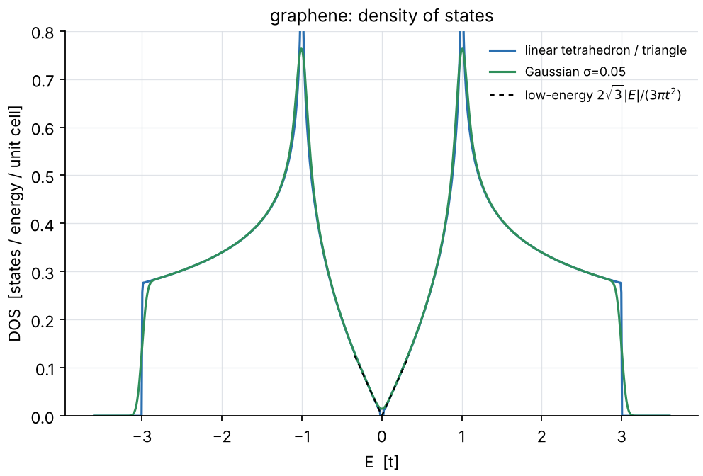
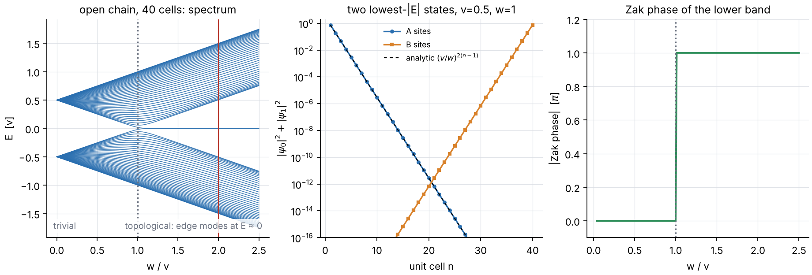

# tblab: a tight-binding lab, checked against analytic results

[](https://github.com/GodelKu/tightbinding-lab/actions/workflows/ci.yml)  

`tblab` is a small, from-scratch Python package for the tight-binding toolbox of an
introductory solid-state course: band structures along high-symmetry paths, density of states
(linear tetrahedron and Gaussian), topological edge states and Zak phase (SSH chain), Berry
curvature and Chern numbers (Haldane model), and the Kronig-Penney model.

The point of the project is not the models themselves (they are textbook) but that **every
headline claim is tested against a closed-form result or an independent method**: the Bloch bands
against a finite lattice built in real space, the Dirac velocity `3ta/2`, `C = ±1` in the
topological Haldane phase, zero-energy SSH edge modes, the analytic Kronig-Penney condition, and
so on. All numbers and figures below were produced by running the code in this repository:
every measured number sits in a block that `tools/fill_readme.py` writes from the JSON files in
`docs/`, and a test fails if README and JSON disagree (see
[Reproducing the figures](#reproducing-the-figures)).

Author: Georgii Baiev. MIT licence. How the code was written and reviewed is described in
[How this was built](#how-this-was-built).


## Install

Python 3.10+ and `numpy`, `scipy`, `matplotlib`.

```bash
git clone https://github.com/GodelKu/tightbinding-lab
cd tightbinding-lab
python -m venv .venv && source .venv/bin/activate
pip install -e ".[dev]"      # package + pytest, ruff, mypy
```

## Command-line usage

Every command writes a PNG **and** a JSON file (parameters, results, raw arrays) into `--out`
(default `./tblab_output`).

```bash
tblab bands graphene --path G-K-M-G
tblab bands square   --path G-X-M-G
tblab bands ssh      --v 0.5 --w 1.0
tblab bands haldane  --t2 0.1 --phi pi/2 --path G-K-M-Kp-G
tblab bands graphene --t 2.7 --a 1.42 --unit eV   # physical-looking parameters, your choice

tblab dos graphene --method both --nk 160      # tetrahedron + Gaussian
tblab dos square

tblab ssh --v 0.5 --w 1.0 --cells 40           # open chain: edge states, Zak phase
tblab berry haldane --t2 0.1 --phi pi/2        # Berry curvature map + Chern number
tblab phase --t2 0.1                           # Haldane phase diagram (phi, M/t2)
tblab kp --v0 20 --well 1 --barrier 0.3        # Kronig-Penney vs plane waves
tblab verify                                   # analytic-vs-numeric table (exit code 1 on failure)
```

Invalid input (for example `--w 0`, `--nk 1` or a parameter the chosen model does not have)
stops with a message and exit code 2.

Example, with the real output of `tblab bands graphene --path G-K-M-G --out docs`:

```text
wrote docs/graphene_bands.png
wrote docs/graphene_bands.json
```

and the `results` block of that JSON file (abridged):

<!-- BEGIN bands_example -->
```json
{
  "labels": ["G", "K", "M", "G"],
  "max_abs_error_vs_analytic": 1.0e-15,
  "real_space_check": {"cells_per_direction": 12, "max_abs_difference": 9.3e-15},
  "direct_gap_at_special_points": {"G": 6.0, "K": 1.35e-15, "Kp": 8.01e-16, "M": 2.0},
  "dirac_points_found_fractional": [[0.3333, 0.6667], [0.6667, 0.3333]],
  "fermi_velocity_numeric": 1.4999999981,
  "fermi_velocity_analytic_3ta/2": 1.5
}
```
<!-- END bands_example -->

Path labels: `G` (also `Gamma`, `Γ`), `K`, `Kp` (also `K'`), `M`, `X`. Energies are in units of the
hopping `t` unless you pass `--t` / `--unit`. The same functionality is available as a library:

```python
from tblab import Graphene, compute_bands, dirac_velocity

res = compute_bands(Graphene(t=1.0, a=1.0), "G-K-M-G", nk=300)
print(dirac_velocity(Graphene(), "K"))  # close to 3ta/2 = 1.5
```

## What it computes, and how it is checked

### Band structures (chain, square lattice, graphene, SSH, Haldane)

The Bloch Hamiltonians `H(k)` are written in closed form for the chain, the square lattice, SSH
and graphene; the Haldane next-nearest-neighbour term is summed from a list of hops whose
chirality is computed from the geometry. Bands are `numpy.linalg.eigh` along a path whose points
are spaced proportionally to Cartesian length. Brillouin zones are constructed as Voronoi cells of
the reciprocal lattice.

- Every model is checked against an independent construction (`tblab.realspace`): a ring or
  torus of unit cells whose Hamiltonian is written in real space as a list of bonds (graphene and
  Haldane bonds are found from the site positions, the Haldane phases by walking each hexagon
  counter-clockwise). Its eigenvalues must equal the Bloch energies at the commensurate wave
  vectors; `tblab bands` reports the largest difference as `real_space_check`. For the one-band
  chain and square lattice this is the only meaningful check: their `H(k)` is the closed form
  itself, so they have no separate "analytic" curve. A torus contains `k` and `-k` together, so
  this check cannot see the sign of the Haldane flux `φ`; that sign is checked by the Chern
  number and the curvature.
- Graphene (`a` = C-C distance, lattice constant `√3 a`): bands vs the closed form `±|f(k)|`
  written with the three bond vectors (atomic gauge, independent of the periodic-gauge `H(k)`);
  bandwidth `6t`; `E(M) = ±t`; a sublattice mass `m` gives the gap `2|m|`. The Dirac velocity is
  estimated from the numerical splitting at `K ± q`, averaged over `±q` because trigonal warping
  makes the one-sided error `O(q)`; the tests check that the error falls as `dq²`, for several
  `(t, a)`, both valleys and five directions.

<!-- BEGIN bands -->
- Largest difference between the real-space spectrum and the Bloch bands (from `tblab verify`): chain (t2 = 0.25) 3.1e-15; square (t2 = 0.2) 1.4e-14; SSH (v = 0.4, w = 1.1) 2.7e-15; graphene (m = 0.3) 9.1e-15; Haldane (phi = 0.7, M = 0.3) 1.6e-14.
- Graphene (`t = a = 1`): bands equal `±|f(k)|` to 1.0e-15; the gap at K and K′ is 1.4e-15.
- Dirac velocity from the numerical bands: `1.4999999981` against `3ta/2 = 1.5` (relative error 1.3e-9).
<!-- END bands -->

- `find_dirac_points` finds the gap minima numerically (grid scan + Nelder-Mead) and returns
  `(1/3, 2/3)` and `(2/3, 1/3)` without being told where they are; the default scan grid
  (61 × 61) does not contain K or K′, and the tests also use 50 and 71.


### Density of states

- **Gaussian broadening** on a uniform `k` grid.
- **Linear tetrahedron method** (segments in 1D, triangles in 2D): each simplex is a linear
  interpolation of `E_n(k)`. The code evaluates the *exact cumulative distribution* of that
  interpolant at bin edges and differences it, so `∫ DOS dE` equals the band count to rounding
  error (table below). Triangles with two or three corners at the same energy (for example a
  corner exactly on the Dirac point) need no special case: the cumulative function stays well
  defined, while a pointwise formula divides by zero there (two equal corners) or has to represent
  a delta function (three equal corners).

<!-- BEGIN dos_table -->
| check | result |
| --- | --- |
| square lattice, tetrahedron vs `K(√(1-(E/4t)²))/(2π² t)`, `0.3t < \|E\| < 3.7t`, nk = 200 | max relative deviation 0.115 % |
| square lattice, Gaussian σ = 0.04, same window, nk = 200 | max relative deviation 0.235 % |
| chain, cumulative DOS vs `1/2 + arcsin(E/2t)/π` | max deviation 5.4e-5 (nk = 750), 1.4e-5 (nk = 1500), 3.5e-6 (nk = 3000) |
| graphene, `∫ DOS dE` (both bands), nk = 48 | 2.000000000000 (error 4.3e-14) |
| graphene, tetrahedron DOS (nk = 240) vs low-energy `2√3 \|E\| / (3π t²)`, `0.05t < \|E\| < 0.3t` | max deviation 3.0 %; at `E = 0.3t` the ratio to the linear law is 1.0309, and 1.0327 from a histogram of `\|f(k)\|` on 9,000,000 points, so the deviation is the band's curvature, not a numerical error |
| graphene van Hove peak (nk = 240) | at `\|E\| = 1.00 t` |
<!-- END dos_table -->



### SSH chain: edge states and the Zak phase

`H(k) = [[0, v + w e^{-ik}], [c.c., 0]]`, inversion-symmetric unit cell.

<!-- BEGIN ssh -->
- Open chain of 40 cells, `v = 0.5, w = 1.0`: the two states closest to zero have `E = -6.8205e-13` and `6.8219e-13`. To leading order the two edge states couple with `w (v/w)^N (1 - (v/w)²)` = `6.8212e-13` (the left state lives on A sites as `(-v/w)^n`, the right one on B sites; `H` applied to the right state leaves only `v (v/w)^(N-1)` on the first A site). The next level is at `0.5032` against the bulk half-gap `|v-w| = 0.5`.
- The fitted decay of the edge density gives `|v/w| = 0.5000000000000111`.
- Zak phase of the lower band from a discretised Wilson loop: `|γ| = 3.1415926535897927` for `w > v`, `3.3e-16` for `w < v`.
<!-- END ssh -->

- The left edge mode decays as `ψ_A(n+1)/ψ_A(n) = -v/w`; the tests check that this analytic
  geometric series lies in the span of the two numerical near-zero eigenvectors.
- In the trivial phase (`v > w`) there are no in-gap states.
- The Zak phase is `π` exactly when the winding number of `v + w e^{ik}` is 1. The loop product is
  invariant under random per-`k` phases of the eigenvectors (tested). With a staggered on-site
  energy `±Δ` (Rice-Mele chain) the phase is no longer quantised; its sign is tested against a
  continuum formula.



### Haldane model: Berry curvature and Chern numbers

Honeycomb lattice with `-t1` nearest-neighbour hopping, `t2 e^{iνφ}` next-nearest-neighbour hopping
(ν computed from the geometry of the hop, not hard-coded) and a sublattice mass `M`. The Chern
number is computed with the Fukui-Hatsugai-Suzuki link-variable method on an `nk × nk` grid, and
the Berry curvature is the plaquette flux per unit area.

- A Chern number is only computed for a gapped band (see Limitations).
- `C(φ) = -C(-φ)`, `C(M) = C(-M)`; the integer does not change with the grid size or a shifted
  grid origin (tested).
- Valley gaps are `2|M - 3√3 t2 sin φ|` at K and `2|M + 3√3 t2 sin φ|` at K′, so the gap closes at
  `M = ±3√3 t2 sin φ`.
- Two independent routes to the curvature: the `d`-vector formula `½ d̂·(∂x d̂ × ∂y d̂)` and the
  Kubo formula `Ω₀ = -2 Im[⟨0|∂xH|1⟩⟨1|∂yH|0⟩]/(E₀ - E₁)²`. Neither uses link variables.

<!-- BEGIN haldane -->
- `t2 = 0.1, φ = π/2, M = 0`, nk = 100: raw plaquette sum `-1.0`, so `C = -1` (check grid nk = 201: `-1.0`).
- `M = 0.8` (beyond `3√3 t2 = 0.5196`): `C = -7.1e-17`.
- `d`-vector formula vs plaquette fluxes: max deviation 3.0e-2 (nk = 60), 7.8e-3 (nk = 120), 2.0e-3 (nk = 240), against a peak `|Ω|` of 4.26; it falls like `1/nk²`, and the signs agree.
- Kubo formula (nk = 120, plaquette centres): `C = -1.0000000000`.
- With the orbital positions included (atomic convention) the curvature map changes by up to 0.69 against a peak of 4.25, while `C = -1.0000000001`.
<!-- END haldane -->

<!-- BEGIN phase -->
- Phase diagram on a 61 × 61 grid of `(φ, M/t2)` with nk = 24: of 3721 points, 3 sit exactly on a gap-closing line (C undefined, excluded) and **0 of the remaining 3718 disagree** with the analytic boundary.
- With nk = 25 (K not on the grid): 16 of 3718 points disagree, all within `|ΔM| ≤ 5.7e-4` of the boundary.
- With nk = 16 (K not on the grid): 40 of 3718 points disagree, all within `|ΔM| ≤ 8.3e-3` of the boundary.
<!-- END phase -->

`nk = 24` is divisible by 3, so `K` and `K′` are grid nodes, which makes the lattice Chern number
unusually robust near the boundary. With other grids the disagreeing points lie next to the
boundary, where the gap is smaller than the grid resolves; the JSON output reports their number.


The curvature map is drawn in the periodic gauge of the Bloch Hamiltonians (see
[Conventions](#conventions)); with the orbital positions included it looks different, while the
Chern number is the same.


### Kronig-Penney

Units `ħ = m = 1`. The analytic Bloch condition `cos(kL) = f(E)` (both `E < V0` and `E > V0`
branches, with a safe `E = V0` limit) is compared with a **separate** plane-wave diagonalisation
(Fourier coefficients of the square-barrier potential).

<!-- BEGIN kp -->
- `V0 = 20`, well 1, barrier 0.3, 201 plane waves: lowest four bands `[2.390, 3.237]`, `[9.225, 12.883]`, `[19.837, 28.755]`, `[34.116, 50.568]`; max `|E_analytic - E_planewave|` per band 4.4e-7, 1.4e-6, 1.9e-6, 2.0e-6.
- Largest error over the four bands against the number of plane waves: 1.4e-4 (51), 1.7e-5 (101), 2.0e-6 (201), 2.6e-7 (401). Each doubling of the basis divides it by 8.0, 8.4, 7.9, consistent with the `1/N³` expected for a step potential (the wave function's second derivative jumps at the steps).
- Thick barriers (`V0 = 100`, barrier 0.8): the lowest band is 1.5e-5 of its energy wide and its centre agrees with the level of a single finite well to 5.2e-11 (relative).
<!-- END kp -->

- Free-particle limit `V0 → 0` recovers `E = k²/2`. The single-well level used above comes from
  the transcendental equation `k tan(k w/2) = κ` of one finite well, independent of the
  Kronig-Penney formula.


### Self-check table (`tblab verify`)

Verbatim output of `tblab verify` (also in [`docs/verify.txt`](docs/verify.txt) and
[`docs/verify.json`](docs/verify.json)):

<!-- BEGIN verify -->
```text
check                                                               analytic       numeric       error       tol  ok
--------------------------------------------------------------------------------------------------------------------
chain (t2 = 0.25): Bloch vs real space, 64 cells                           0   3.10862e-15    3.11e-15     1e-12  PASS (abs)
square (t2 = 0.2): Bloch vs real space, 24x24 cells                        0   1.37668e-14    1.38e-14     1e-12  PASS (abs)
SSH (v = 0.4, w = 1.1): Bloch vs real space, 64 cells                      0   2.66454e-15    2.66e-15     1e-12  PASS (abs)
graphene (m = 0.3): Bloch vs real space, 12x12 cells                       0   9.10383e-15    9.10e-15     1e-12  PASS (abs)
Haldane (phi = 0.7, M = 0.3): Bloch vs real space, 12x12 cells             0   1.62093e-14    1.62e-14     1e-12  PASS (abs)
graphene: Dirac velocity vs 3ta/2                                      5.751         5.751    2.52e-09     1e-06  PASS (rel)
graphene: gap at K                                                         0    2.1616e-15    2.16e-15     1e-12  PASS (abs)
graphene: DOS(0.1t) vs 2√3|E|/(3πt²)                               0.0367553     0.0371197    9.92e-03     3e-02  PASS (rel)
square: DOS(2t) vs K(m)/(2π²t)                                       0.10925      0.109257    6.43e-05     2e-02  PASS (rel)
SSH (v=.5,w=1, N=40): |E_edge| vs w(v/w)^N(1-(v/w)²)             6.82121e-13   6.82121e-13    6.96e-13     1e-03  PASS (rel)
SSH: edge decay ratio |v/w|                                              0.5           0.5    2.22e-14     1e-06  PASS (rel)
SSH topological: |Zak phase|                                         3.14159       3.14159    4.44e-16     1e-09  PASS (abs)
SSH trivial: |Zak phase|                                                   0   3.34802e-16    3.35e-16     1e-09  PASS (abs)
Haldane topological (M=0): |C|                                             1             1    0.00e+00     1e-06  PASS (abs)
Haldane trivial (M=0.8, > 3√3 t2): C                                       0   -7.0679e-17    7.07e-17     1e-06  PASS (abs)
Haldane (M=0.3): gap at K = 2|M - 3√3 t2 sinφ|                       0.43923       0.43923    1.11e-16     1e-12  PASS (abs)
Haldane (M=0.3): gap at Kp = 2|M + 3√3 t2 sinφ|                      1.63923       1.63923    4.44e-16     1e-12  PASS (abs)
Kronig-Penney: max |E_analytic - E_planewave| (4 bands)                    0   2.04765e-06    2.05e-06     1e-04  PASS (abs)
graphene BZ area = (2π)²/A_cell                                      15.1953       15.1953    3.51e-16     1e-10  PASS (rel)
19/19 checks passed
```
<!-- END verify -->

(The graphene velocity row uses `t = 2.7`, `a = 1.42` only to exercise unit scaling; `t` and `a` are
free parameters here, not fitted values.)

## Tests

```bash
pytest
ruff check . && ruff format --check .
mypy
```

CI runs these four steps and a command-line smoke test on Linux, macOS and Windows with Python
3.10 to 3.13. The tests of planned features in `tests/test_roadmap.py` are marked as expected
failures (see [Roadmap](#roadmap)).

| file | what is compared with what |
| --- | --- |
| `test_chain_square.py` | Bloch bands vs real-space rings and tori (with second-neighbour hopping); the ring spectrum vs `ε - 2t cos(2πm/n) - 2t2 cos(4πm/n)`; effective mass `t a²` at the band bottom by finite difference; `E(Γ,X,M) = -4t, 0, +4t` |
| `test_realspace.py` | SSH, graphene and Haldane Bloch bands vs real-space supercells; coordination numbers; sensitivity to `φ` (and blindness to `φ → -φ`) |
| `test_graphene.py` | bands vs `±\|f(k)\|`; particle-hole symmetry; `E(Γ) = ±3t`, `E(M) = ±t`; gap 0 at K/K'; Dirac velocity `3ta/2` for 3 parameter sets × 2 valleys × 5 directions; `dq²` convergence; slope fit along K→Γ; numerically located Dirac points; gap `2m` with a sublattice mass |
| `test_ssh.py` | sign of the Berry phase against a continuum formula for the Rice-Mele chain (staggered on-site `±Δ`, phase not quantised); bulk `±\|v + w e^{-ik}\|`, gap `2\|v-w\|`; chiral symmetry of the open chain; two zero modes iff `w > v` with `\|E\| ≲ w (v/w)^N`; analytic zero mode `(-v/w)^n` inside the numerical zero-mode subspace; fitted decay ratio; sublattice/edge localisation; Zak phase 0/π, winding number, gauge invariance |
| `test_haldane.py` | Hermiticity and exact periodicity `H(k+G) = H(k)`; reduces to graphene at `t2 = 0`; closed-form bands; valley gaps `2\|M ∓ 3√3 t2 sin φ\|` assigned to the labelled valleys (derived by hand); `C = ±1` / `0`; Chern sign against the Kubo formula; sign under `φ → -φ`; independence of grid size and origin; gauge invariance of the plaquette product; FHS curvature vs the `d`-vector formula; scan over `(φ, M)` against the analytic boundary |
| `test_chern_guard.py` | gapless graphene is refused on and between grid nodes; a too coarse grid near the transition is refused; the CLI refuses gapless parameters |
| `test_dos.py` | second-order convergence against a dense histogram for a band without inversion or mirror symmetry (both triangles of every cell are used); exact normalisation; chain cumulative DOS; square DOS vs elliptic integral; graphene linear DOS, particle-hole symmetry and van Hove peak; Gaussian vs tetrahedron; SSH gap |
| `test_kronig_penney.py` | free limit; `E = V0` continuity and closed form; transcription of both branches; plane-wave eigenvalues satisfy the analytic condition; convergence with basis size; band edges at `\|f\| = 1`; isolated-well limit; bandwidth vs barrier width |
| `test_kpath.py` | K and K′ labels against their hand-derived Cartesian positions; path parsing, segment lengths from hand-derived geometry, BZ area `(2π)²/A`, K/M positions |
| `test_cli.py` | every sub-command writes a valid PNG (magic bytes) and JSON with the expected results; the DOS deviation recomputed from the JSON with scipy; phase-diagram entries against hand values on both sides of `\|M/t2\| = 3√3 \|sin φ\|`; a failing check makes `tblab verify` exit with 1; invalid input and parameters the model does not have stop with exit code 2 and a message; the trivial SSH phase has no edge-mode labels; angle parser (no `eval`) |
| `test_verify.py` | all checks in `tblab verify` pass |
| `test_readme_sync.py` | every generated README block equals what `tools/fill_readme.py` builds from `docs/*.json` |
| `test_roadmap.py` | known answers for the planned extensions, `xfail(strict=True)` until implemented |

As a check on the tests themselves, the independent review described in
[How this was built](#how-this-was-built) applied deliberate bugs (mutations) to the code one at a
time and ran the suite against each; the mutations it did not catch are listed in
[`CHANGELOG.md`](CHANGELOG.md) together with the tests added for them.
[`tools/mutation_check.py`](tools/mutation_check.py) repeats the experiment with the review's
mutations plus mutations of the code added in version 0.2 and writes the outcome to
[`docs/mutation_check.json`](docs/mutation_check.json).

<!-- BEGIN mutation -->
The suite catches 37 of 37 mutations.
<!-- END mutation -->

## Conventions

- `ħ = 1`; `H = -t Σ c†c` so a positive `t` gives `E(k) = -2t cos ka` for the chain.
- Graphene/Haldane `a` is the **C-C bond length** (lattice constant `√3 a`), which is why the Dirac
  velocity is `3ta/2`.
- Bloch Hamiltonians use the *periodic gauge* (`H(k+G) = H(k)`): the Bloch phase of a hop
  depends only on the lattice vector between the cells, not on the positions of the orbitals inside
  the cell. Energies do not depend on this choice, and neither does the Chern number. **The Berry
  curvature map does.** Including the orbital positions (the "atomic" convention, B at
  `τ = (a1 + a2)/3`, whose curvature is the one in semiclassical dynamics) adds `τ |u_B|²` to the
  connection and `τ_y ∂x|u_B|² − τ_x ∂y|u_B|²` to `Ω(k)`; that term integrates to zero over the zone
  because `|u_B|²` is periodic. The plotted map is the periodic-gauge one;
  `berry_curvature_kubo(..., orbital_positions=...)` gives the other, and a test checks the
  formula for the difference.
- Berry connection `A = i⟨u|∇u⟩`, curvature `Ω = ∂x Ay − ∂y Ax`, `C = (1/2π)∫Ω d²k`. With the
  next-nearest-neighbour chirality ν defined as +1 for a left turn, this code gives `C = -sign(t2 sin φ)`
  in the topological phase. The sign depends on conventions; the magnitude and the phase boundary do not.
- K and K′: `K = (1/3, 2/3)` in reduced coordinates is the zone corner at polar angle 60°,
  `K′ = (2/3, 1/3)` the corner on the `+kx` axis (lattice `a1 = (√3a, 0)`,
  `a2 = (√3a/2, 3a/2)`). Which corner is called K is a convention; the tests pin it. With it the
  Haldane gap is `2|M - 3√3 t2 sin φ|` at K and `2|M + 3√3 t2 sin φ|` at K′.
- The sign in the Haldane closed form (`HALDANE_SIGN` in `analytic.py`) was first fixed by
  comparing with the Hamiltonian. It also follows by hand: from an A site the hops along `a1`,
  `a2 - a1` and `-a2` turn right (`ν = -1`), so `dz = M - 2 t2 sin φ Σ sin(k·b)`; the valley-gap
  test spells out this derivation. The Chern-number sign is checked by two methods that do not
  use the closed form: the `d`-vector curvature and the Kubo formula.

## Project layout

```text
src/tblab/
  models.py          Bloch Hamiltonians (Chain, SSH, Square, Graphene, Haldane)
  kpath.py           k-path construction and Brillouin-zone polygons
  bands.py           band structure along a path
  dos.py             Gaussian and linear-tetrahedron DOS
  topology.py        Berry phase, Zak phase, FHS Chern number, d-vector curvature
  ssh.py             open SSH chain, edge states
  kronig_penney.py   analytic condition + plane-wave solver
  analysis.py        Dirac velocity, Dirac-point search
  analytic.py        closed-form reference formulas (no diagonalisation)
  realspace.py       finite periodic lattices built from bond lists (independent check)
  verify.py          `tblab verify` table
  plotting.py        matplotlib figures (OO API, headless-safe)
  cli.py             `tblab` command
tests/               pytest suite (test_readme_sync.py: README numbers equal docs/*.json)
tools/
  measure.py         README numbers that no command writes -> docs/measurements.json
  fill_readme.py     writes the generated blocks of this README from docs/*.json
  mutation_check.py  deliberate bugs, one at a time -> docs/mutation_check.json
docs/                figures, JSON and verify table generated by scripts/make_docs.sh
.github/workflows/ci.yml
```

## Reproducing the figures

```bash
pip install -e ".[dev]"
bash scripts/make_docs.sh           # figures and JSON in docs/, then measure.py and fill_readme.py
python tools/mutation_check.py      # optional, a few minutes: docs/mutation_check.json
python tools/fill_readme.py         # after the mutation check, to update its block
```

## Limitations (please read)

- **This is a teaching implementation, not a replacement for Wannier90 or any production
  electronic-structure code.** There is no first-principles input, no Wannier interpolation, no
  spin, spin-orbit coupling, interactions or self-consistency. The models are hand-written with
  free hopping parameters; nothing is fitted to a real material, and the numbers (`t`, `a`) used
  in examples are not claims about graphene.
- DOS: only 1D (segments) and 2D (triangles) linear interpolation; no 3D tetrahedra, no symmetry
  reduction, no Blöchl corrections. The graphene low-energy comparison in the table measures how
  far nearest-neighbour graphene is from the linear law, not only the numerical error. One fixed
  diagonal per grid cell breaks the lattice symmetry slightly.
- Chern numbers use the single-band FHS method; it needs a gapped band and a grid that resolves the
  curvature. `chern_number` raises `GapClosedError` when the band touches a neighbour on the grid.
  A touching *between* grid points (graphene's Dirac points when `nk` is not a multiple of 3)
  leaves a finite gap on the grid and would still give an integer; `converged_chern_number`,
  which `tblab berry` uses, repeats the calculation on a `2nk+1` grid and refuses when the
  smallest gap shrinks under refinement or the two integers differ. `tblab berry graphene` with
  `--mass 0` is refused for this reason. There is no multi-band (non-Abelian) or Wilson-loop flow
  implementation.
- Kronig-Penney band edges are found by scanning the energy axis. Bands narrower than about the
  scan step are caught via local minima of `|f|`, but bandwidths below double-precision
  resolution (relative to the band energy, reached for very thick barriers) are not resolved. The plane-wave solver converges only
  algebraically for a discontinuous potential.
- No performance benchmarks are claimed; large DOS grids are slow in pure NumPy.
- The plots are static PNGs; there is no interactive viewer.

## Roadmap

[`docs/ROADMAP.md`](docs/ROADMAP.md) lists five extensions, each with a known-answer test that
is marked as an expected failure until it is implemented: hybrid Wannier charge centres of the
Haldane model, the chiral edge states of a Haldane ribbon, the Kane-Mele model and its Z2
invariant, the Hofstadter butterfly with Chern numbers from the Středa formula, and Dirac points
moved and merged by strain. [`CHANGELOG.md`](CHANGELOG.md) lists what changed in each version.

## References

- F. D. M. Haldane, Model for a quantum Hall effect without Landau levels: condensed-matter
  realization of the "parity anomaly", Phys. Rev. Lett. 61, 2015 (1988).
- T. Fukui, Y. Hatsugai and H. Suzuki, Chern numbers in discretized Brillouin zone: efficient
  method of computing (spin) Hall conductances, J. Phys. Soc. Jpn. 74, 1674 (2005).
- W. P. Su, J. R. Schrieffer and A. J. Heeger, Phys. Rev. Lett. 42, 1698 (1979).
- J. Zak, Berry's phase for energy bands in solids, Phys. Rev. Lett. 62, 2747 (1989).
- A. H. Castro Neto, F. Guinea, N. M. R. Peres, K. S. Novoselov and A. K. Geim, The electronic
  properties of graphene, Rev. Mod. Phys. 81, 109 (2009).

## Licence

MIT, see [`LICENSE`](LICENSE). Copyright (c) 2026 Georgii Baiev.

## How this was built

I chose the models and the rules for checking them: every headline number is compared with an
analytic limit or a closed-form result, important results are reproduced by a second, independent
method, and the test suite itself is checked by deliberately breaking the code (mutation checks).
The first implementation was written with an AI coding assistant (Claude). An independent review
by a second model (Claude Fable 5.2) re-derived the main results with its own code and found the
problems listed in [`CHANGELOG.md`](CHANGELOG.md): checks that compared a formula with itself,
README numbers that did not match their stated configuration, a Chern number reported for a
gapless band, and mutations the tests did not catch. Version 0.2, also written with the
assistant, fixes them. The extensions in [`docs/ROADMAP.md`](docs/ROADMAP.md) are mine to
implement.

Commits made with the assistant carry a `Co-Authored-By` line.
